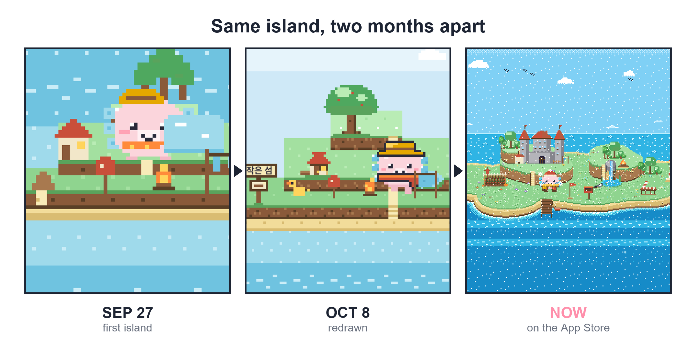
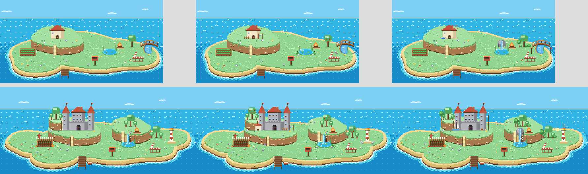

I've downloaded more habit apps than I can count. Every time I remembered I wanted to get better at something, I'd install a new one, use it for a bit, and then quietly stop opening it.

At some point I had to admit I'm not as diligent as I'd like to be. So I built the tool I needed instead: a habit app where every check grows a little pixel island, and missing a day costs you nothing.

This is what that island looked like along the way.

## Sep 27: the first island

The first version was a side view. One strip of ground, a house, a tree, a campfire, and Podo, way too big, standing in the middle of it. It ran in SpriteKit and it worked, but it looked like a sticker floating on water. There was nowhere for it to grow.

## Oct 8: redrawn

I gave it terraces, a sign with the island's name, a lighthouse, a duck. It felt much more alive. But it was still a flat strip, so "growing" just meant putting more things in a row.

## Oct 12: v4

This is the one that stuck. I switched to a top-down island with real height: cliffs, stairs, a pier. I also split each island into layers (ground, fixed buildings, and effects like smoke or sparkles) so each building can grow on its own. A house becomes a castle. A pond gets a fountain.

There are 14 islands now, each with 3 levels, and Podo walks around on them using the actual stairs (mostly).

## Rules I didn't break

A few rules kept the art consistent while it changed this much:

- Colors only come from a fixed palette, never a hand-typed hex.
- Pixels only scale by whole numbers (3x, 5x, 8x), so nothing gets blurry.
- Animations step frame by frame. No smooth tweening.
- No failure messages anywhere. Nothing in the app tells you that you missed.

## Things that broke

**Widgets that turned gray.** A tester in New York kept seeing a gray placeholder instead of their island on the home screen. Widgets get killed at around 30 MB, and my widget was loading the sprites for every island just to draw one. Now it loads only the shared sheet and the island you're on. Peak memory while drawing went from about +18.6 MB down to +5.8 MB.

**The day that had 25 hours.** On Nov 1, daylight saving time ended in the US, and the same tester's widget froze. I had calculated midnight as "start of today + 24 hours". On a 25-hour day that lands at 11 pm, and after 11 pm the widget kept scheduling the same moment over and over. The fix was to ask the calendar for the next midnight instead of doing the math myself. Then I added tests that run through DST changes in five time zones, every 15 minutes.

## Still growing

The island has changed more in two months than I expected, and it'll probably change again. If you want to grow one too, Isleday is on the [App Store](https://apps.apple.com/app/isleday/id6816646663). 🏝️
